# AFCToolBox工具箱

<div align="left">
  
  
  
</div>

**AFCToolBox 是一款面向无人机飞控快速开发的开源MATLAB/Simulink工具箱，配套 AFCDTCom 上位机监测软件，支持飞控算法建模、自动代码生成、工程编译、硬件一键烧录全流程开发。**

---
> 📚 文档导航：<br>
> [总入口（导航仓库）](https://github.com/zqhkd/flight-control-toolbox) ｜ [English](./README_EN.md)<br>
> **本工具箱：** [中文](./README.md) ｜ [English](./README_EN.md)<br>
> **相关工具箱：** [ASEToolBox 实时仿真](https://github.com/zqhkd/ASEToolBox) ｜ [English](https://github.com/zqhkd/ASEToolBox/blob/main/README_EN.md)

---
##  1. AFCToolBox概述

ACG 团队采购了AFC系列飞控硬件，基于MATLAB/Simulink 搭建开发环境，自主研制 AFCToolBox 工具箱。现正式将工具箱源代码完整开源，欢迎大家使用、交流与二次开发。


 <em>图1 AFC飞控实体图</em>

##  2. 核心功能

AFCToolBox 是一款面向无人机飞控快速开发的开源MATLAB/Simulink工具箱，配套 AFCDTCom 上位机监测软件，支持飞控算法建模、自动代码生成、工程编译、硬件一键烧录全流程开发。
AFCToolBox完全公开开源，所有用户可免费下载、使用、修改、二次开发，支持学生学习、个人开发等全场景使用。本文档详细记录环境部署、软件安装、工具使用、故障排查全流程，适配 AFC全系飞控硬件设备。
核心功能：Simulink可视化建模、嵌入式C代码自动生成、Keil工程一键编译、Hex固件生成、STLink/JLink硬件自动烧录、飞控传感器数据实时监测。

##  3. 前置软件安装教程

使用AFCToolBox工具箱前，需提前安装编译、烧录必备软件，所有工具均为通用开源开发工具，可免费获取使用。

### 3.1 Keil MDK5 安装与激活

Keil MDK5 为STM32嵌入式代码编译核心环境。

1、以管理员身份运行 `MDK529.exe` 安装程序；

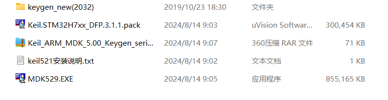

2、自定义软件安装路径，建议将Core核心程序与Pack器件库安装至同一根目录，务必记录安装路径，后续环境变量配置需使用；

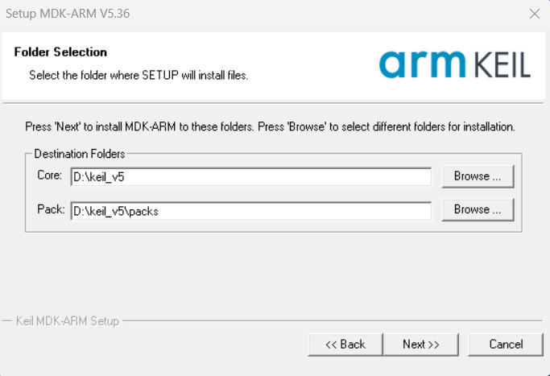

3、**授权说明**：Keil MDK 为商业软件，需通过官方渠道获取合法授权（商业许可证，或符合条件的免费社区版/教育版），并通过 **File → License Management** 完成激活。请勿使用来源不明的授权工具，此类工具可能携带恶意程序，且违反软件许可协议。

---
### 3.2 STLink 烧录工具安装
STLink为STM32通用烧录工具，是AFCToolBox默认主流下载器，必装软件。
1、打开前置安装目录，解压 STM32 STLink Utility 压缩包；
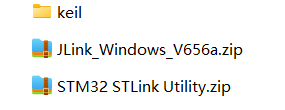
2、双击运行安装程序 STM32 STLink Utility.exe，跟随安装向导推进；
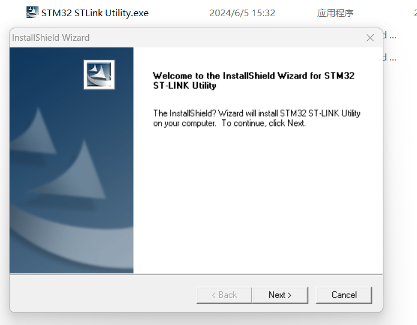
3、自定义安装路径并记录，用于后续环境变量配置；
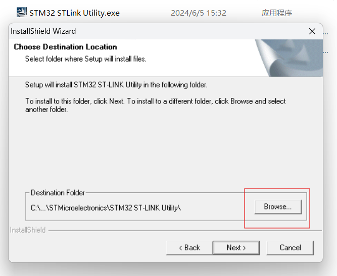
4、完成安装，确认电脑成功识别STLink驱动，工具可正常使用。
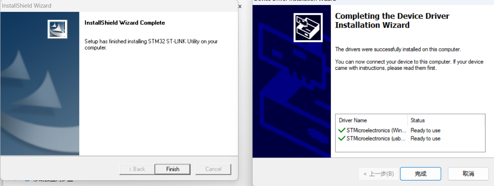
### 3.3 JLink 烧录工具安装（可选）
JLink为备用烧录工具，功能与STLink一致，用户仅使用STLink时可跳过安装。

1、解压前置安装目录下的 JLink_Windows_V656a.zip 压缩包；


2、双击运行安装程序，自定义安装路径并记录；
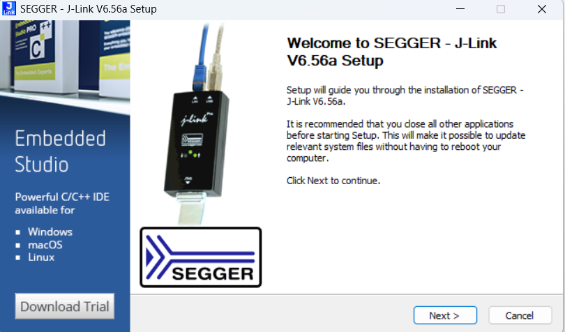
3、默认勾选USB驱动、运行组件，完成安装即可。
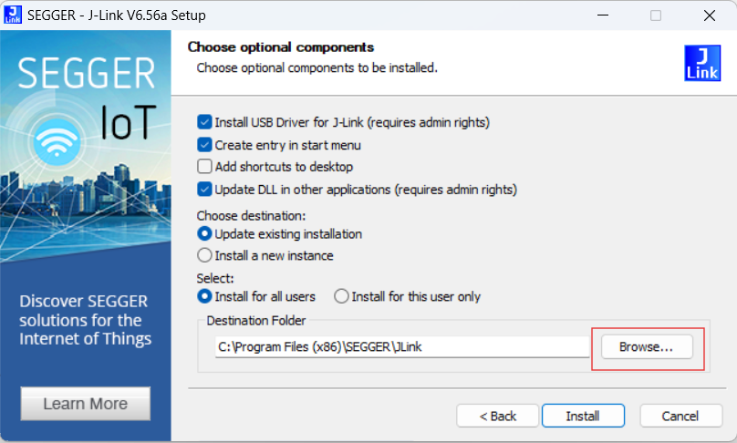

---

### 3.4 国产操作系统适配（银河麒麟 / 统信 UOS）

AFCToolBox 已完成在主流国产操作系统上的适配验证，支持在 **银河麒麟 Kylin V10（桌面版）** 与 **统信 UOS V20（桌面版）** 上完整运行飞控开发全流程。适配要点如下：

**① MATLAB 环境**
- MATLAB R2023a+ 的 Linux x86_64 安装包可直接在银河麒麟 / 统信 UOS 上正常安装运行，Simulink 建模、自动代码生成（ERT/TLC）全链路可用，安装方式与 Ubuntu/Linux 完全一致。

**② 编译工具链：Keil MDK5 → arm-none-eabi-gcc + CMake**
Keil MDK5 为 Windows 专属软件，国产 OS 下推荐使用开源 ARM 交叉编译工具链替代。AFCToolBox 已在代码生成模板中预留工具链切换接口，编译脚本自动适配：

```bash
# 银河麒麟 / 统信 UOS 下安装 ARM 交叉编译器
sudo apt update
sudo apt install -y gcc-arm-none-eabi binutils-arm-none-eabi libnewlib-arm-none-eabi cmake build-essential
```

安装完成后，将系统环境变量 `KeilCC` 设置为编译器路径（如 `/usr/bin/arm-none-eabi-gcc`）即可，工具箱自动识别并调用。

> 若仍需使用 Keil MDK5，可通过 Wine / 虚拟机（如 GNOME Boxes）运行，操作方式与 Windows 一致。

**③ 烧录工具：STLink / JLink Linux 原生支持**
烧录工具均有 Linux 原生命令行版本，在国产 OS 上可直接使用，无需 Wine：

```bash
# 安装 st-flash（STLink 命令行工具）
sudo apt install -y stlink-tools

# 安装 JLink 命令行工具（从 SEGGER 官网下载 .deb 包安装）
wget https://www.segger.com/downloads/jlink/JLink_Linux_V788c_x86_64.deb
sudo dpkg -i JLink_Linux_V788c_x86_64.deb
```

安装后分别将 `STLinkProgramer` / `JlinkProgramer` 环境变量指向 `st-flash` / `JLinkExe` 可执行文件路径（通常为 `/usr/bin/st-flash`），工具箱一键烧录功能自动适配。

**④ AFCDTCom 上位机监测软件**
AFC5DTCom.exe 为 Windows 原生程序，国产 OS 下有两种使用方式：
- **Wine 方案**：安装 `wine64` 后直接运行，串口通信功能正常；
- **MATLAB 原生方案**：AFCToolBox 内置 `DTCom` 模块，可在 MATLAB 命令行直接读取飞控传感器串口数据，实现与 AFCDTCom 等效的实时监测功能。

**⑤ 适配验证清单**

| 验证项 | 国产 OS 下的验证方式 |
| --- | --- |
| MATLAB/Simulink 启动 | `matlab` 命令行启动，确认可打开 Simulink |
| AFCToolBox 路径加载 | `addpath(genpath('AFCAPP/AFCToolBox'))` 无报错 |
| 代码生成 | 运行 Demo 模型，成功生成 C 代码 |
| 编译烧录 | 执行 AutoDeploy，飞控板指示灯正常 |
| 串口监测 | DTCom 模块 / Wine 版 AFCDTCom 正常显示数据 |

> 更多信创环境部署细节可参考总 README 中的"国产操作系统适配"章节，遇到问题欢迎在 GitHub Issue 中反馈。

---
 ##  4. AFCToolBox核心软件安装
### 4.1 AFCToolBox工具箱部署配置
1、在电脑非中文路径下新建根文件夹，命名为 AFC-X（适配AFC系列硬件或新版硬件）；
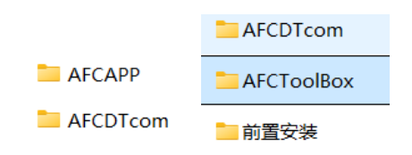
2、在根文件夹内新建两个子文件夹：AFCAPP（存放工具箱核心程序）、AFCDTcom（存放监测软件）；

3、将AFCToolBox压缩包完整解压至 AFCAPP 目录下，解压后包含工具箱核心脚本、模块库、测试Demo、底层驱动等文件；

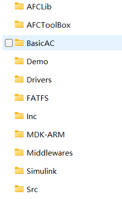

4、版本更新说明：后续工具箱升级，直接将新版本文件覆盖至当前目录，无需重复配置MATLAB路径与系统环境变量；

5、MATLAB路径配置：打开MATLAB软件，进入设置路径界面，先删除旧版本AFCToolBox残留路径，再点击【添加并包含子文件夹】，选中 AFCAPP\AFCToolBox 目录，保存配置；

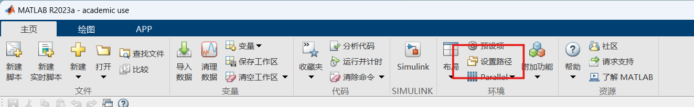
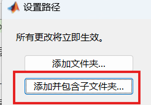
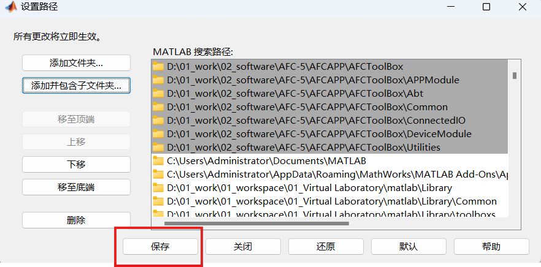
6、工具箱内置 Demo测试文件，用户可直接运行测试，验证工具箱安装是否成功，也可自行新增自定义测试模型。

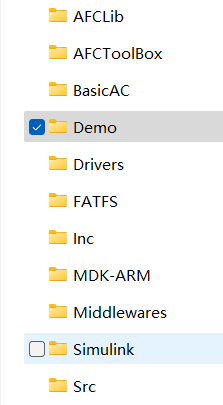

### 4.2 AFCDTCom监测软件安装

1、将AFCDTCom压缩包解压至对应根目录的 AFCDTcom 文件夹中；

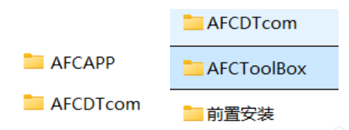
2、解压完成后，目录内核心启动程序为 AFC5DTCom.exe；

3、配置完系统环境变量后，双击该程序即可启动飞控数据实时监测功能。

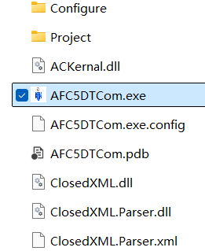

### 4.3 系统环境变量统一配置

环境变量为工具箱正常运行、自动编译烧录的核心配置，必须严格按规范设置，路径需与软件实际安装路径完全一致。

打开方式：此电脑右键属性 - 高级系统设置 - 环境变量 - 新建系统变量，具体配置如下：

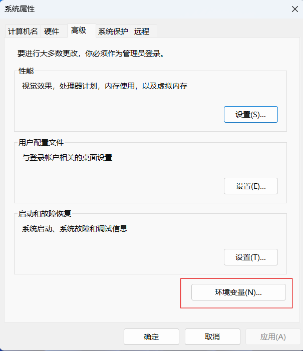

1、AFC-5硬件专属变量：AFC5ProjectPath，变量值：自定义AFC-5\AFCAPP完整路径

2、AFC-6及新版硬件变量：AFCProjectPath，变量值：自定义AFC-6\AFCAPP完整路径（无数字后缀）

3、Keil编译路径变量：KeilCC，默认值：C:\Keil v5\UV4（自定义安装需修改为实际路径）

4、STLink工具路径变量：STLinkProgramer，默认值：C:\Program Files (x86)\STMicroelectronics\STM32 ST-LINK Utility\ST-LINK Utility

5、JLink工具路径变量：JlinkProgramer，默认值：C:\Program Files (x86)\SEGGER\JLink

> **国产 OS 路径说明**：在银河麒麟 / 统信 UOS 下，KeilCC 替换为 ARM 交叉编译器路径（如 `/usr/local/arm-none-eabi-gcc` 或 `/opt/gcc-arm-none-eabi/bin`），STLinkProgramer 替换为 `st-flash` 可执行文件路径（如 `/usr/bin/st-flash`），JlinkProgramer 替换为 `JLinkExe` 路径。具体见下文"国产操作系统适配"章节。

配置完成后重启MATLAB，确保所有环境变量生效。

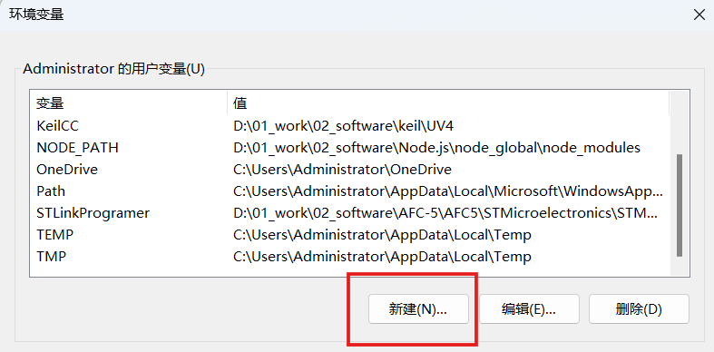

---

##  5. AFCToolBox工具箱使用教程（Demo实例）

本章以IST8310磁力计数据串口监测为例，演示工具箱完整建模、编译、烧录、调试流程。

### 5.1 新建Simulink模型

在MATLAB当前文件夹空白处右键，选择【新建-模型】，创建空白Simulink模型，命名为 AFC5DEMO.slx，保存至纯英文无空格路径。

### 5.2 模型核心参数配置

1、点击Simulink界面【建模】-【模型设置】，进入求解器配置页面；

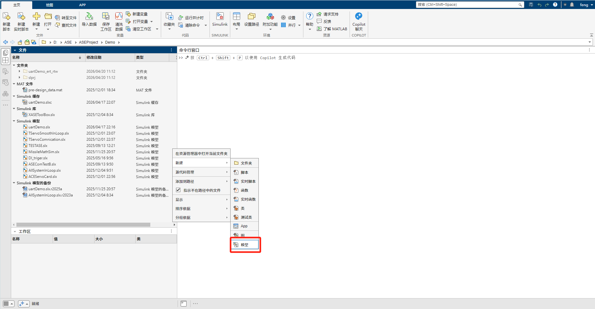

2、求解器类型选择定步长，求解器选择 ode4(Runge-Kutta)；

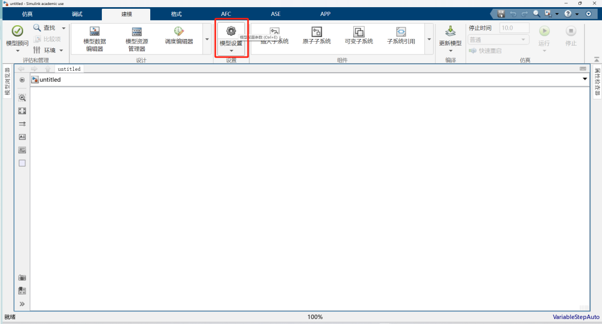

3、设置固定步长为0.01s（可根据项目需求自定义，禁止设置为auto自动模式）；

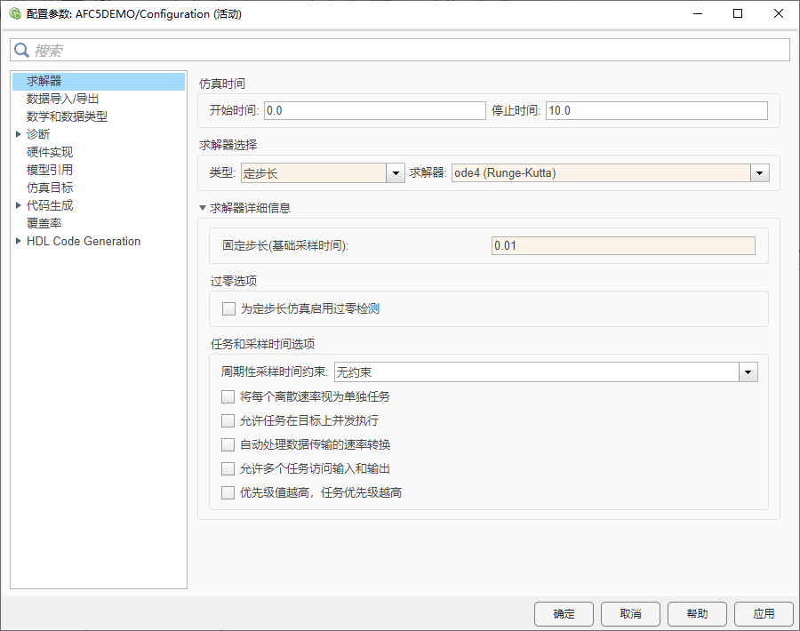

4、进入【代码生成】-【目标选择】，浏览选择系统目标文件 AFCHawk.tlc；

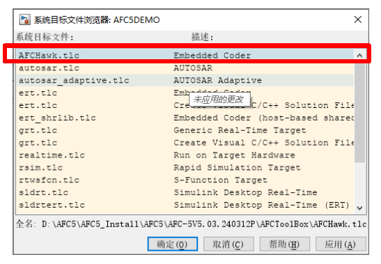

5、选中目标文件后，页面新增【AFC-5 Option】选项，勾选 Build C Project to Hex File、Auto Download to Target Board 两项，点击确定保存配置。

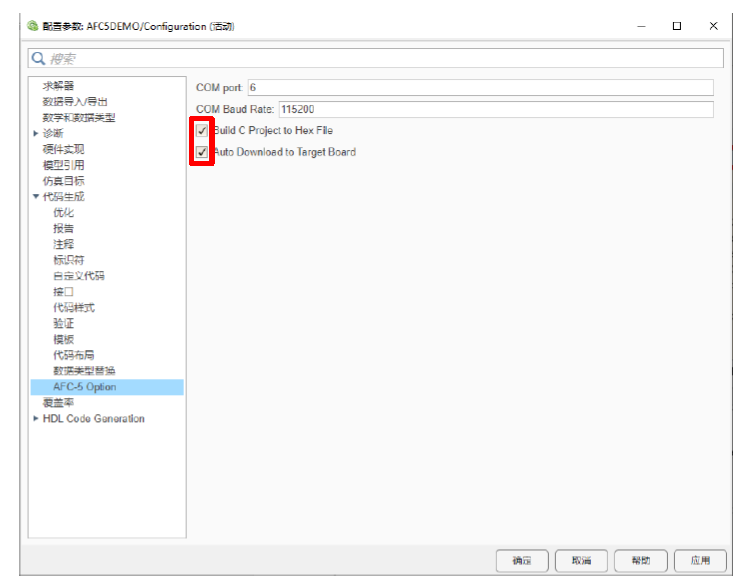

### 5.3 调用开源工具箱模块建模

1、返回Simulink主界面，顶部工具栏出现 AFC5/AFC 专属选项卡；

2、打开库浏览器，展开 AFC5ToolBox/AFCToolBox，包含两大开源模块库：

- APPModule：飞控应用算法通用模块

- DeviceModule：外设驱动模块（传感器、串口、通信等）

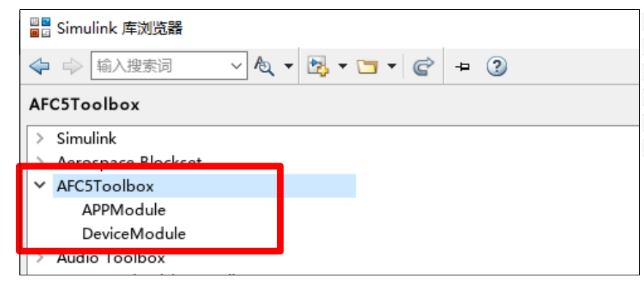

3、本次演示拖拽 IST8310磁力计模块、DTComOut数据输出模块，完成信号连线，搭建基础数据采集模型。

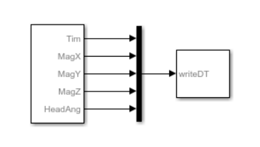

### 5.4 一键编译部署至飞控硬件

1、硬件连接：将AFC系列飞控板通过STLink/JLink连接电脑USB接口，确保驱动识别正常；

2、确认MATLAB当前文件夹与模型存放路径一致，全程禁止中文、空格、特殊符号；

3、点击工具栏 AutoDeploy 自动部署按钮；

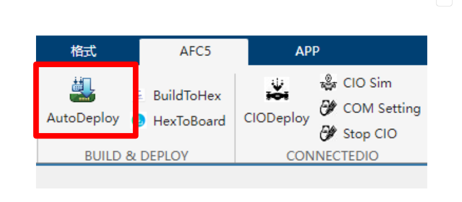

4、系统自动执行模型编译、C代码生成、Keil工程构建、Hex固件编译、硬件烧录复位全流程；

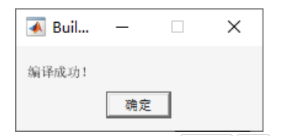

5、弹出编译成功弹窗即部署完成，打开AFCDTCom软件即可实时查看磁力计采集数据。

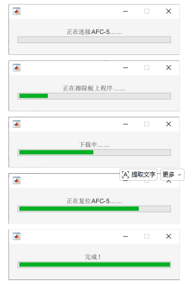

6、一键部署完成之后，即可在AFCtest上实时监测到飞控传感器数据。

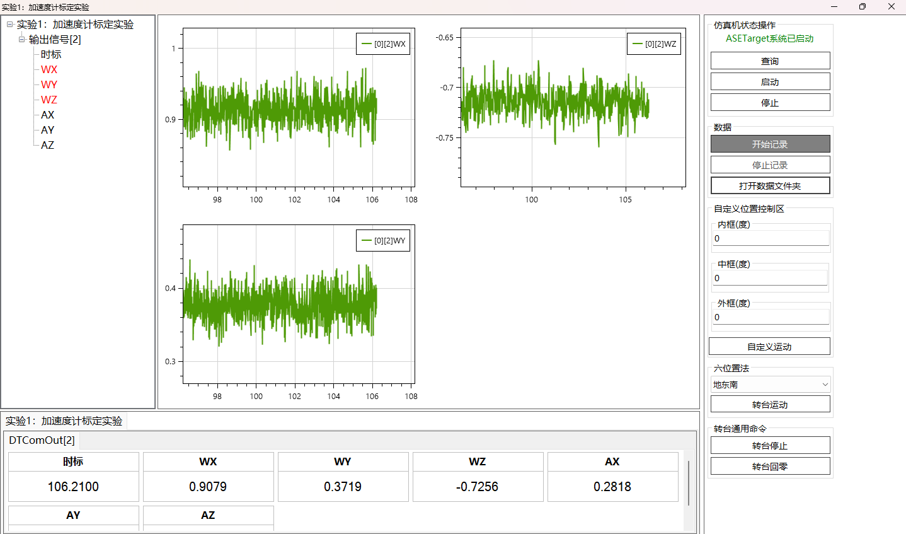

---

## 📧 6. 作者与联系方式 (Contact)

本项目由中山大学ACG团队开发与维护。 如果您对代码实现有疑问、发现 Bug 或有进一步的学术合作意向，欢迎通过以下方式联系：

  个人邮箱 (Permanent): zqhkd@qq.com 


* **环境要求**：MATLAB R2023a或更高版本。
* **版权**： 中山大学 航空航天学院. 遵循 MIT 协议。