# AFCToolBox

<div align="left">
  
  
  
</div>

**An open-source MATLAB/Simulink toolbox for rapid UAV flight-controller development. Working together with the AFCDTCom ground monitoring software, it covers the entire workflow: flight-control algorithm modelling, automatic code generation, project build, and one-click firmware flashing.**

---
> 📚 Document Navigation:<br>
> [Home (Hub)](https://github.com/zqhkd/flight-control-toolbox) | [English](https://github.com/zqhkd/flight-control-toolbox/blob/main/README_EN.md)<br>
> **This toolbox:** [Chinese](./README.md) | [English](./README_EN.md)<br>
> **Related toolbox:** [ASEToolBox — real-time simulation](https://github.com/zqhkd/ASEToolBox) | [English](https://github.com/zqhkd/ASEToolBox/blob/main/README_EN.md)

---

## Contents

1. [Overview](#1-overview)
2. [Core Features](#2-core-features)
3. [Prerequisite Software Installation](#3-prerequisite-software-installation)
4. [Installing AFCToolBox](#4-installing-afctoolbox)
5. [Usage Tutorial (Demo)](#5-usage-tutorial-demo)
6. [Authors and Contact](#6-authors-and-contact)

---

## 1. Overview

The ACG team procured AFC flight-controller hardware, built a development environment on MATLAB/Simulink, and developed the AFCToolBox toolbox in-house. The complete source code is now officially open-sourced — contributions, discussion and secondary development are welcome.

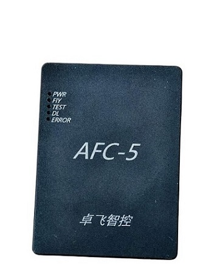

*Figure 1 — AFC flight-controller hardware.*

## 2. Core Features

AFCToolBox is an open-source MATLAB/Simulink toolbox for rapid UAV flight-controller development. Together with the AFCDTCom ground monitoring software it covers the full workflow: flight-control algorithm modelling, automatic code generation, project build and one-click hardware flashing.

AFCToolBox is fully open-source: anyone may download, use, modify and extend it free of charge, which makes it suitable for student learning, personal projects and many other scenarios. This document describes the complete process — environment deployment, software installation, tool usage and troubleshooting — and supports the entire AFC flight-controller family.

**Core capabilities:** visual modelling in Simulink, automatic embedded C code generation, one-click Keil project build, Hex firmware generation, automatic flashing via STLink / JLink, and real-time monitoring of flight-controller sensor data.

## 3. Prerequisite Software Installation

Before using AFCToolBox, install the software required for compilation and flashing. All of these are common, freely available development tools.

### 3.1 Installing Keil MDK5

Keil MDK5 is the core build environment for STM32 embedded code.

1. Run the `MDK529.exe` installer as administrator.

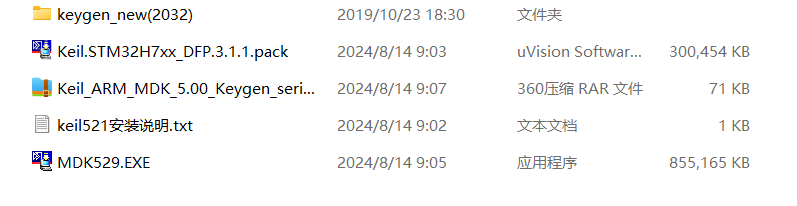

2. Choose a custom installation path and record it — the `KeilCC` environment variable must point to it later. It is recommended to install the core programs and the device pack library under the same root directory.

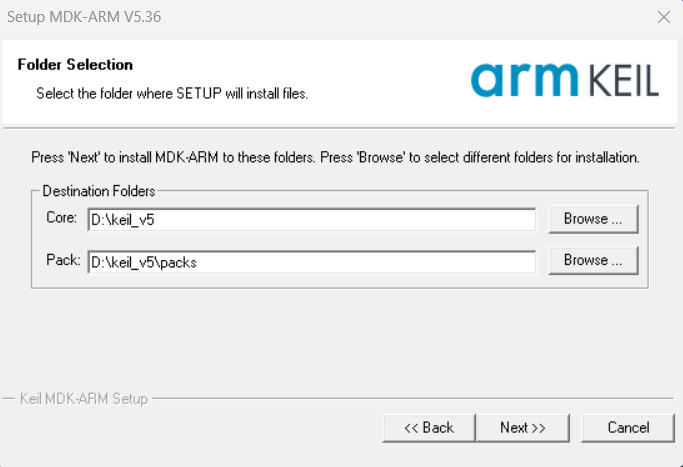

3. **Licensing:** Keil MDK is commercial software and requires a valid license. Obtain it through official channels (a commercial license, or one of the free community / educational editions where you are eligible) and activate it via **File → License Management**. Avoid license tools of unknown origin: they can carry malware, and using them breaches the license terms.

---
### 3.2 Installing the STLink flashing tool

STLink is the common STM32 flashing utility and the default programmer for AFCToolBox — it must be installed.

1. Open the prerequisites directory and extract the `STM32 STLink Utility` archive.


2. Double-click `STM32 STLink Utility.exe` and follow the installation wizard.

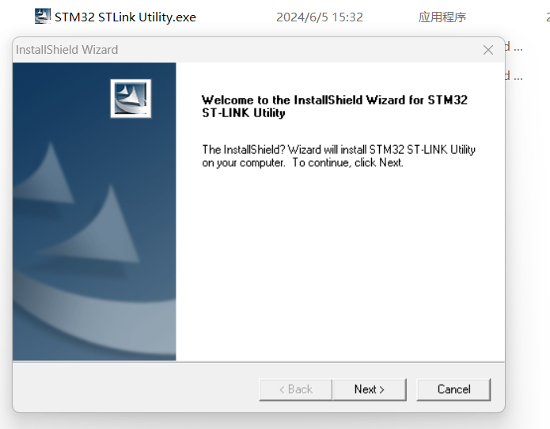

3. Choose a custom installation path and record it — it is needed for the environment variables later.

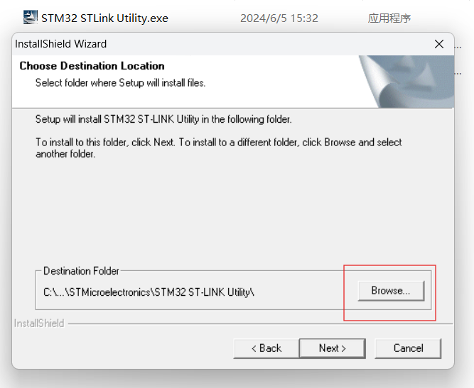

4. Once installation finishes, confirm that Windows recognises the STLink driver and that the tool runs correctly.

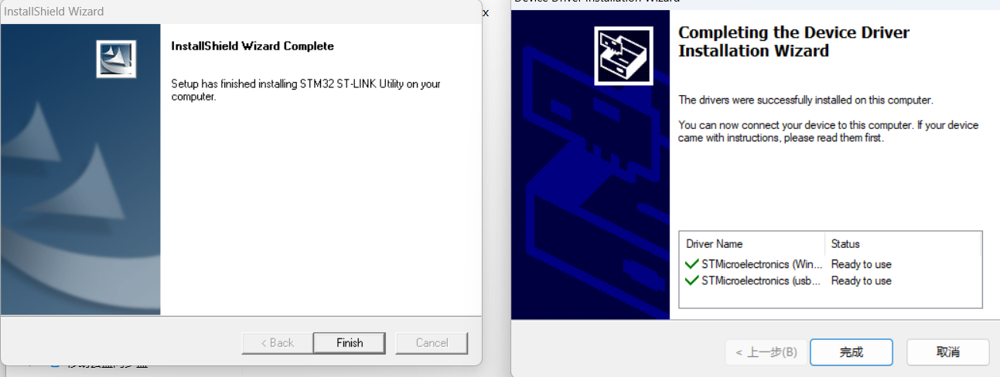

### 3.3 Installing the JLink flashing tool (optional)

JLink is an alternative programmer with the same functionality as STLink. If you only use STLink, you can skip this section.

1. Extract `JLink_Windows_V656a.zip` from the prerequisites directory.


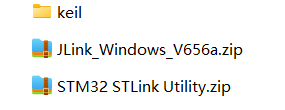

2. Double-click the installer, choose a custom installation path and record it.

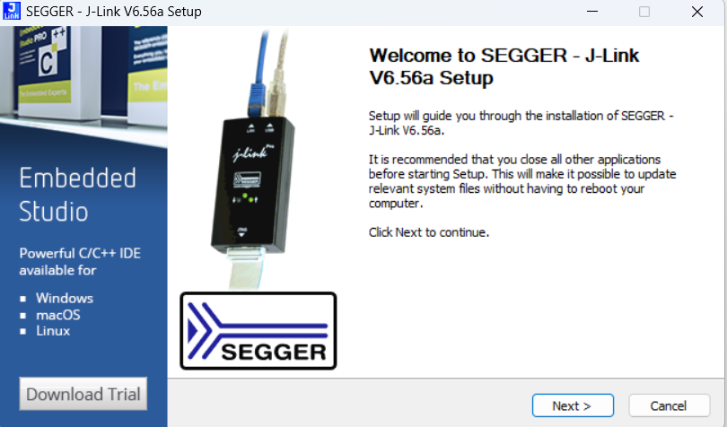

3. Keep the default USB driver and runtime components selected, then finish the installation.

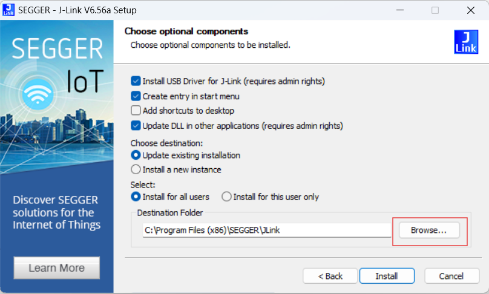

---

### 3.4 Domestic OS support (Kylin / UOS)

AFCToolBox has been validated on mainstream domestic operating systems and supports the complete flight-controller development workflow on **Kylin V10 (Desktop)** and **UOS V20 (Desktop)**. Key adaptation points:

**① MATLAB environment**

The Linux x86_64 installer of MATLAB R2023a+ installs and runs normally on Kylin / UOS. Simulink modelling and automatic code generation (ERT/TLC) are fully available, and installation is identical to Ubuntu/Linux.

**② Build toolchain: Keil MDK5 → arm-none-eabi-gcc + CMake**

Keil MDK5 is Windows-only; on a domestic OS we recommend the open-source ARM cross-compiler toolchain instead. AFCToolBox already reserves a toolchain switch in the code-generation templates, and the build scripts adapt automatically:

```bash
# Install the ARM cross-compiler on Kylin / UOS
sudo apt update
sudo apt install -y gcc-arm-none-eabi binutils-arm-none-eabi libnewlib-arm-none-eabi cmake build-essential
```

After installation, point the `KeilCC` environment variable to the compiler path (e.g. `/usr/bin/arm-none-eabi-gcc`); the toolbox detects and uses it automatically.

> If you still need Keil MDK5, it can run through Wine or a virtual machine (e.g. GNOME Boxes), with the same operation as on Windows.

**③ Flashing tools: native Linux support for STLink / JLink**

Both programmers have native Linux command-line builds that work on a domestic OS without Wine:

```bash
# Install st-flash (STLink command-line tool)
sudo apt install -y stlink-tools

# Install the JLink command-line tool (download the .deb from the SEGGER website)
wget https://www.segger.com/downloads/jlink/JLink_Linux_V788c_x86_64.deb
sudo dpkg -i JLink_Linux_V788c_x86_64.deb
```

Then point the `STLinkProgramer` / `JlinkProgramer` environment variables to the `st-flash` / `JLinkExe` executables (usually `/usr/bin/st-flash`); the one-click flashing feature adapts automatically.

**④ AFCDTCom monitoring software**

`AFC5DTCom.exe` is a native Windows program. On a domestic OS there are two options:

- **Wine:** install `wine64` and run it directly; serial communication works normally.
- **Native MATLAB:** AFCToolBox includes a built-in `DTCom` module that reads flight-controller sensor data from the serial port directly in the MATLAB command window, providing real-time monitoring equivalent to AFCDTCom.

**⑤ Validation checklist**

| Item | How to verify on a domestic OS |
| --- | --- |
| MATLAB/Simulink startup | Launch `matlab` from the command line and confirm Simulink opens |
| AFCToolBox path loading | `addpath(genpath('AFCAPP/AFCToolBox'))` completes without errors |
| Code generation | Run the demo model and confirm C code is generated |
| Build and flash | Run AutoDeploy; the flight-controller board LED behaves normally |
| Serial monitoring | The DTCom module, or AFCDTCom under Wine, displays data correctly |

> For more detail on deploying in a Xinchuang environment, see the "Domestic OS support" section of the top-level README. If you run into problems, please open a GitHub Issue.

---

## 4. Installing AFCToolBox

### 4.1 Deploying the toolbox

1. Create a root folder at a path with no Chinese characters, named `AFC-X`.

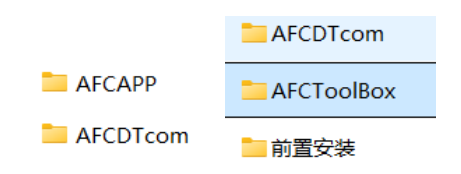

2. Inside the root folder, create two sub-folders: `AFCAPP` (toolbox core) and `AFCDTcom` (monitoring software).

3. Extract the AFCToolBox archive completely into the `AFCAPP` directory. It contains the toolbox scripts, block libraries, test demos and low-level drivers.

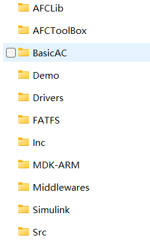

4. **Updating versions:** for later releases, simply overwrite the files in the current directory — there is no need to reconfigure the MATLAB path or the system environment variables again.

5. **MATLAB path:** open MATLAB and go to Set Path. First remove any stale AFCToolBox paths left by an older version, then click **Add with Subfolders**, select the `AFCAPP\AFCToolBox` directory and save.

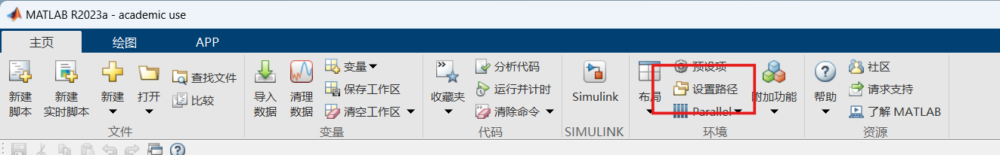
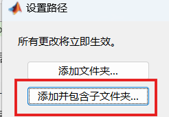
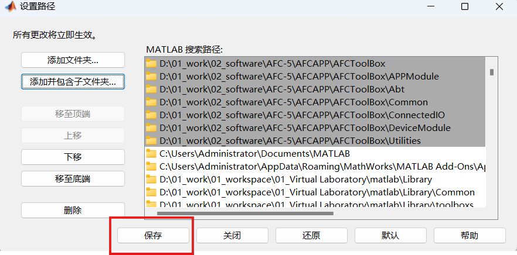

6. The toolbox ships with demo files you can run directly to verify the installation, and you can add your own test models.

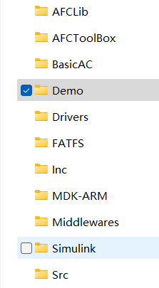

### 4.2 Installing the AFCDTCom monitoring software

1. Extract the AFCDTCom archive into the `AFCDTcom` folder inside the corresponding root directory.

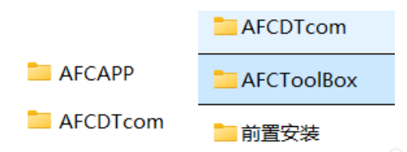

2. The main executable in that directory is `AFC5DTCom.exe`.

3. After the environment variables are configured, double-click it to start real-time flight-controller data monitoring.

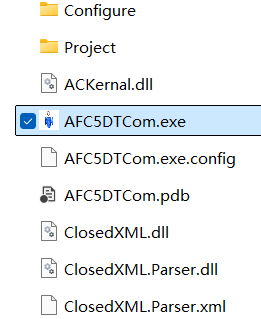

### 4.3 Configuring the system environment variables

The environment variables are essential for the toolbox to run and to build/flash automatically. They must be set exactly as specified, and each path must match the actual installation location of the software.

Open them via: right-click **This PC → Properties → Advanced system settings → Environment Variables → New (System variable)**.

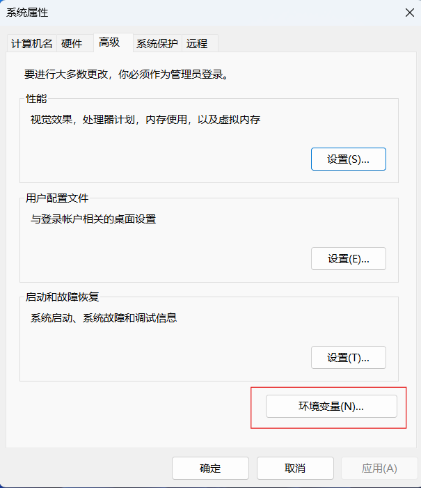

1. **AFC-5 hardware only** — `AFC5ProjectPath`: the full path to `<your root>\AFCAPP` for AFC-5.
2. **AFC-6 and newer hardware** — `AFCProjectPath`: the full path to `<your root>\AFCAPP` for AFC-6 (no numeric suffix).
3. **Keil build path** — `KeilCC`, default `C:\Keil v5\UV4` (change it if you installed Keil elsewhere).
4. **STLink tool path** — `STLinkProgramer`, default `C:\Program Files (x86)\STMicroelectronics\STM32 ST-LINK Utility\ST-LINK Utility`.
5. **JLink tool path** — `JlinkProgramer`, default `C:\Program Files (x86)\SEGGER\JLink`.

> **Domestic OS paths:** on Kylin / UOS, set `KeilCC` to the ARM cross-compiler path (e.g. `/usr/local/arm-none-eabi-gcc` or `/opt/gcc-arm-none-eabi/bin`), `STLinkProgramer` to the `st-flash` executable (e.g. `/usr/bin/st-flash`) and `JlinkProgramer` to the `JLinkExe` path. See the "Domestic OS support" section above for details.

Restart MATLAB after configuring the variables so that they all take effect.

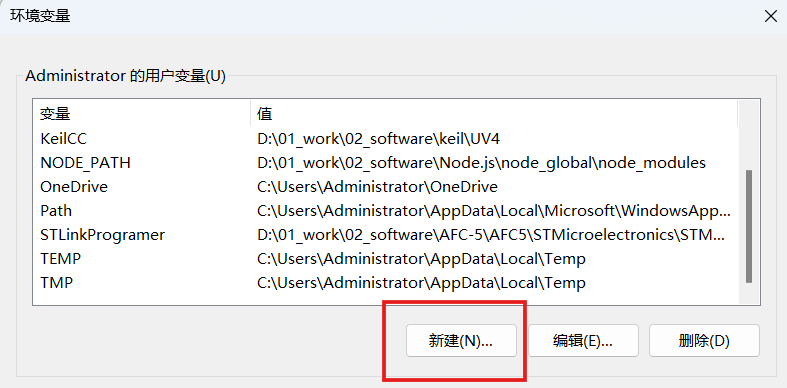

---

## 5. Usage Tutorial (Demo)

This chapter walks through the complete modelling, build, flash and debug workflow, using serial monitoring of IST8310 magnetometer data as the example.

### 5.1 Create a Simulink model

Right-click in an empty area of the MATLAB current folder and choose **New → Model** to create a blank Simulink model. Name it `AFC5DEMO.slx` and save it to a path that contains only ASCII characters and no spaces.

### 5.2 Configure the core model parameters

1. In Simulink, open **Modeling → Model Settings** to reach the solver configuration page.

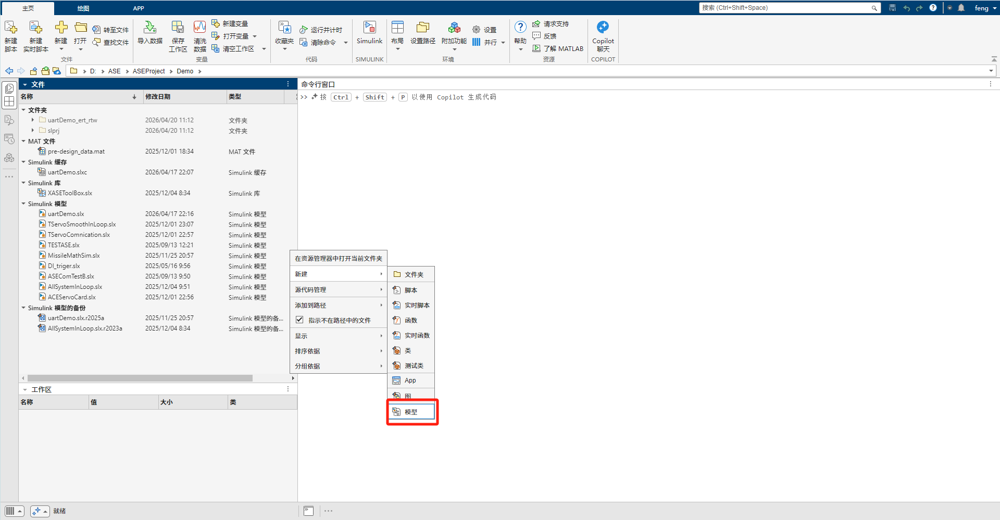

2. Set the solver type to **Fixed-step** and the solver to **ode4 (Runge-Kutta)**.

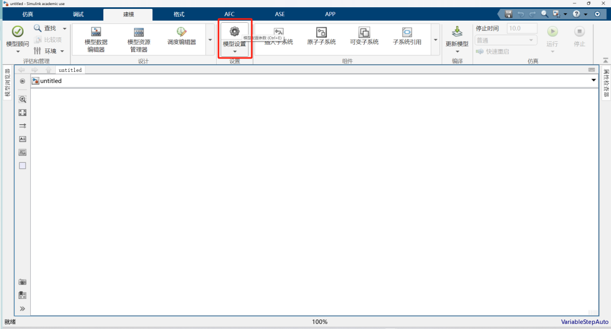

3. Set the fixed step size to `0.01` s (adjust to your project as needed; `auto` is not permitted).

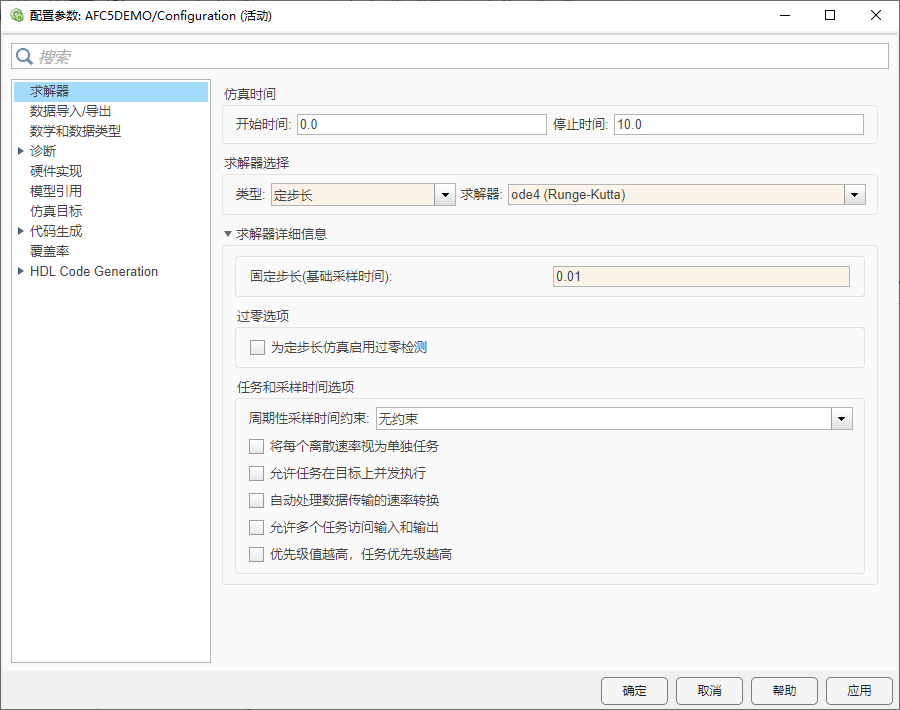

4. Go to **Code Generation → System target file** and browse to `AFCHawk.tlc`.

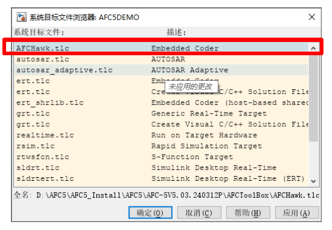

5. Once the target file is selected, an **AFC-5 Option** tab appears. Tick **Build C Project to Hex File** and **Auto Download to Target Board**, then click OK to save.

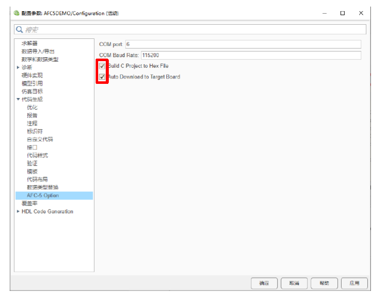

### 5.3 Build the model with the open-source block libraries

1. Back in the Simulink window, an **AFC5/AFC** tab appears in the toolbar.

2. Open the Library Browser and expand `AFC5ToolBox/AFCToolBox`, which contains two open-source block libraries:

   - **APPModule** — general flight-control application algorithm blocks;
   - **DeviceModule** — peripheral driver blocks (sensors, serial ports, communications, etc.).

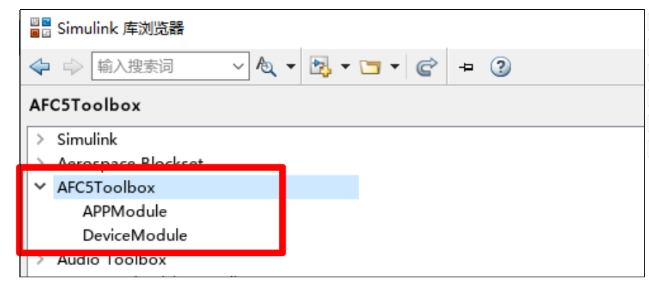

3. For this demo, drag in the **IST8310 magnetometer** block and the **DTComOut** data-output block, wire them up, and build a basic data-acquisition model.

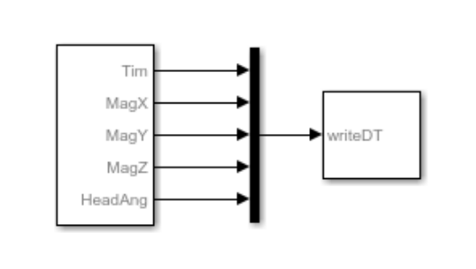

### 5.4 One-click build and deploy to the flight controller

1. **Hardware connection:** connect the AFC-series flight-controller board to a USB port of the PC via STLink/JLink, and confirm the driver is recognised.

2. Make sure the MATLAB current folder is the folder where the model is stored. No Chinese characters, spaces or special symbols anywhere in the path.

3. Click **AutoDeploy** in the toolbar.

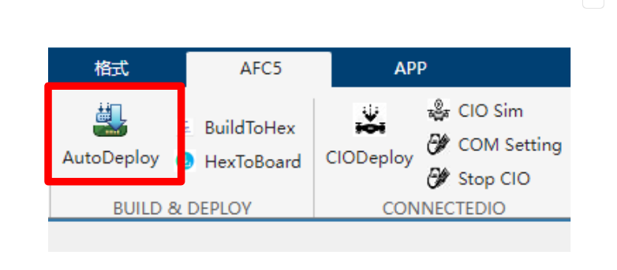

4. The system then runs the whole chain automatically: model compile, C code generation, Keil project build, Hex firmware compilation, and flashing plus reset of the hardware.

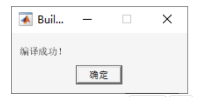
5. When the "build succeeded" dialog appears, deployment is complete. Open AFCDTCom to view the magnetometer data in real time.
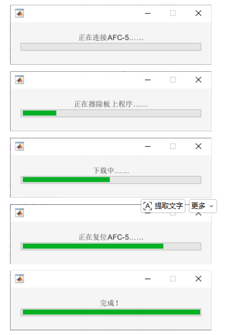

6. After one-click deployment, flight-controller sensor data can be monitored in real time in AFCtest.

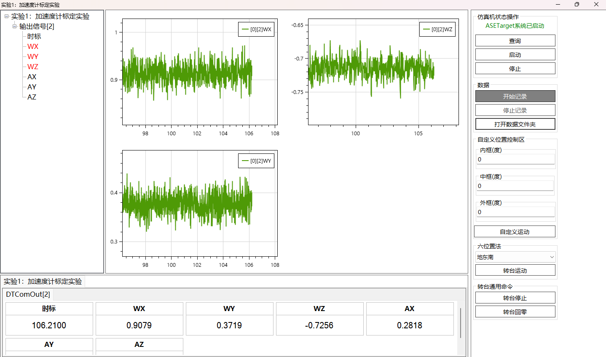

---

## 6. Authors and Contact

This project is developed and maintained by the ACG team at Sun Yat-sen University. If you have questions about the implementation, find a bug, or are interested in academic collaboration, please get in touch:

- **Email:** zqhkd@qq.com

---

- **Requirements:** MATLAB R2023a or later.
- **Copyright:** School of Aeronautics and Astronautics, Sun Yat-sen University. Licensed under the MIT License.